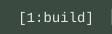
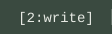
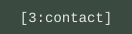

<a href="https://trine.dev">
<picture>
  <source media="(prefers-color-scheme: dark)" srcset="banner_dark.svg">
  
</picture>
</a>
<a href="https://trine.dev"><picture><source media="(prefers-color-scheme: dark)" srcset="tabs/about_dark.svg"></picture></a><a href="#building"><picture><source media="(prefers-color-scheme: dark)" srcset="tabs/build_dark.svg"></picture></a><a href="https://blog.trine.dev"><picture><source media="(prefers-color-scheme: dark)" srcset="tabs/write_dark.svg"></picture></a><a href="mailto:hi@trine.dev"><picture><source media="(prefers-color-scheme: dark)" srcset="tabs/contact_dark.svg"></picture></a><a href="https://trine.dev"><picture><source media="(prefers-color-scheme: dark)" srcset="tabs/site_dark.svg"></picture></a>

I build AI agents and the harnesses that let them ship without a human pressing `y`.

<table>
<thead>
<tr>
<th align="left" width="56%"><samp>~/building</samp></th>
<th align="left" width="44%"><samp>~/writing</samp></th>
</tr>
</thead>
<tbody>
<tr>
<td valign="top">

[**Hearth**](https://github.com/zerone0x/hearth) · a self-hosted agent host. Every session gets its own cloud desktop, keeps running after the laptop closes, and picks up on a phone. `early`

[**LiveCaptions**](https://github.com/zerone0x/mac-live-captions) · live English captions for any audio on a Mac, near the notch, recognised on device. `v0.1.1`

[**Beltworks**](https://github.com/zerone0x/beltworks) · a factory game in the browser, deterministic sim in a worker. [`play`](https://zerone0x.github.io/beltworks-play/)

[**FitTube**](https://github.com/zerone0x/fittube) · fitness videos that lifting communities actually recommend, not an algorithm. [`browse`](https://zerone0x.github.io/fittube/)

</td>
<td valign="top">

<!--START_SECTION:blog-->
- [On Units: The PR and Its Author](https://blog.trine.dev/posts/2026-11-12-units/) - 2026-11-13
- [On Self-Improvement：怎么知道它真的变好了](https://blog.trine.dev/posts/2026-10-23-self-improvement-zh/) - 2026-10-23
- [On Self-Improvement](https://blog.trine.dev/posts/2026-10-23-self-improvement/) - 2026-10-23
- [On Routing](https://blog.trine.dev/posts/2026-09-29-routing/) - 2026-09-29
- [On Markov: The Best Move From Here](https://blog.trine.dev/posts/2026-09-28-onmarkov/) - 2026-09-29
<!--END_SECTION:blog-->

</td>
</tr>
</tbody>
</table>

<h3><samp>~/upstream</samp></h3>

When the open-source agents I use fall short, I fix them upstream:

[OpenCode](https://github.com/anomalyco/opencode) · [OpenClaw](https://github.com/openclaw/openclaw) · [Serena](https://github.com/oraios/serena) · [Beads](https://github.com/gastownhall/beads) · [Nanocoder](https://github.com/Nano-Collective/nanocoder) · [Karakeep](https://github.com/karakeep-app/karakeep) · [Google Workspace CLI](https://github.com/googleworkspace/cli) · [Agent Device](https://github.com/callstack/agent-device) · [mcp-go](https://github.com/mark3labs/mcp-go) · [many others](https://github.com/pulls?q=is%3Apr+author%3Azerone0x+is%3Amerged+-user%3Azerone0x)
