<picture>
  <source media="(prefers-color-scheme: dark)" srcset="banner_dark.svg">
  
</picture>

<samp>[0:<a href="https://trine.dev">about</a>] [1:<a href="#building">build</a>] [2:<a href="https://blog.trine.dev">write</a>] [3:<a href="mailto:hi@trine.dev">contact</a>]</samp>

I build AI agents and the systems they run on, the way Factorio taught me: design the factory, don't do the work. Right now that factory is loops, checks and gates, so a coding agent can finish the job without anyone pressing `y`.

<table>
<tr>
<td valign="top" width="56%">

<h3 id="building"><samp>~/building</samp></h3>

[**Hearth**](https://github.com/zerone0x/hearth) · a self-hosted agent host. Every session gets its own cloud desktop, keeps running after the laptop closes, and picks up on a phone. `early`

[**LiveCaptions**](https://github.com/zerone0x/mac-live-captions) · live English captions for any audio on a Mac, near the notch, recognised on device. `v0.1.1`

[**Beltworks**](https://github.com/zerone0x/beltworks) · a factory game in the browser, deterministic sim in a worker. [`play`](https://zerone0x.github.io/beltworks-play/)

[**FitTube**](https://github.com/zerone0x/fittube) · fitness videos that lifting communities actually recommend, not an algorithm. [`browse`](https://zerone0x.github.io/fittube/)

</td>
<td valign="top" width="44%">

<h3><samp>~/writing</samp></h3>

<!--START_SECTION:blog-->
- [On Units: The PR and Its Author](https://blog.trine.dev/posts/2026-11-12-units/) - 2026-11-13
- [On Self-Improvement：怎么知道它真的变好了](https://blog.trine.dev/posts/2026-10-23-self-improvement-zh/) - 2026-10-23
- [On Self-Improvement](https://blog.trine.dev/posts/2026-10-23-self-improvement/) - 2026-10-23
- [On Routing](https://blog.trine.dev/posts/2026-09-29-routing/) - 2026-09-29
- [On Markov: The Best Move From Here](https://blog.trine.dev/posts/2026-09-28-onmarkov/) - 2026-09-29
<!--END_SECTION:blog-->

</td>
</tr>
</table>

When the open-source agents I use fall short, I fix them upstream: [OpenClaw](https://github.com/openclaw/openclaw/pulls?q=is%3Apr+author%3Azerone0x+is%3Amerged), [OpenCode](https://github.com/anomalyco/opencode/pulls?q=is%3Apr+author%3Azerone0x+is%3Amerged), [Serena](https://github.com/oraios/serena/pulls?q=is%3Apr+author%3Azerone0x+is%3Amerged), [Beads](https://github.com/gastownhall/beads/pulls?q=is%3Apr+author%3Azerone0x+is%3Amerged), [Karakeep](https://github.com/karakeep-app/karakeep/pulls?q=is%3Apr+author%3Azerone0x+is%3Amerged) and [others](https://github.com/pulls?q=is%3Apr+author%3Azerone0x+is%3Amerged+-user%3Azerone0x).
